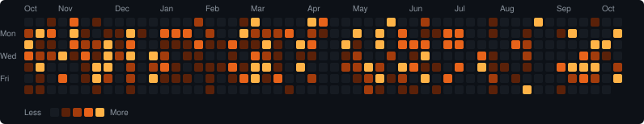

# Hi, I'm Diovani Facco 👋

**PHP / Laravel back-end developer** — I build products end to end, from the database schema and business rules to the interface people actually use.

---

## 🐘 Main language

## 🧑‍💻 About me

I work mostly with **PHP and Laravel**, designing REST APIs, domain models and database schemas — the kind of business logic that has to be *correct*: scheduling, permissions, dynamic pricing, concurrency.

- 🔭 Currently building back-end services in **PHP/Laravel**, paired with cross-platform front-ends (Expo / React Native).
- 🎯 Strong points: REST API design, domain modeling, business rules and clean cross-platform UI.
- 🧪 I write tests for the tricky parts — concurrency, authorization, pricing — not just the happy path.
- 🐳 I ship with Docker and deploy to Railway.

## 🛠️ Tech stack

**Back-end — where I focus**

**Front-end & mobile**

**Tooling & infra**

## 📌 A few projects

- **[ponto-guardian](https://github.com/DiovaniFacco/ponto-guardian)** — desktop app (Electron + TypeScript) that watches your workday and lets you clock in straight from the tray.
- **[querylab-2](https://github.com/DiovaniFacco/querylab-2)** — ask a question in plain language and get SQL, the results and an explanation back.
- **[finza-telegram](https://github.com/DiovaniFacco/finza-telegram)** — Telegram bot that turns text, voice and receipts into tracked expenses, with a web dashboard.
- **[JardimBotanico](https://github.com/DiovaniFacco/JardimBotanico)** — installable PWA for the UFSM Botanical Garden: interactive plant map and visit scheduling.

More on my [repositories](https://github.com/DiovaniFacco?tab=repositories).

## 📊 GitHub

 

---

**Let's talk** — [LinkedIn](https://www.linkedin.com/in/diovani-facco-3a247b11a/) · [diovanifacco@gmail.com](mailto:diovanifacco@gmail.com)

